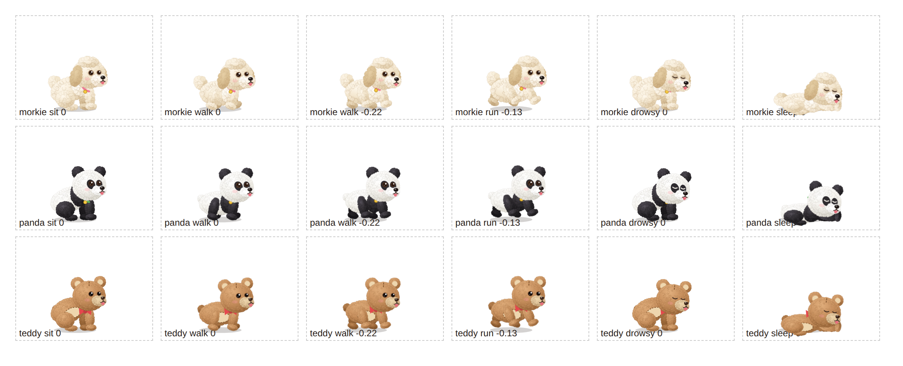

# Cursor Puppy

A little pet that lives in a house at the bottom-left of your screen and follows your cursor around.
Pick a curly Morkie (Snowy), a panda (Bao) or a teddy bear (Honey).

**[Try it in your browser](https://vijaykadapala07.github.io/cursor-puppy/)** ·
**[Download for Mac (Apple Silicon)](https://github.com/vijaykadapala07/cursor-puppy/releases/latest)**

- `cursor-puppy.html`: the browser demo. Open it in any browser. All the art, animations and behaviour live here.
- `index.html`: a copy of the demo so GitHub Pages serves it at the short link. Keep it in step with `cursor-puppy.html`.
- `desktop-app/`: the Mac app (Electron). See [desktop-app/README.md](desktop-app/README.md) for install, run and build steps.

What it does: click the house (or the paw in the menu bar) to call your pet, play ball, tie it in
front of the house, send it to bed (it goes inside and sleeps with its head out of the door), switch
pet or rename it. Leave the mouse still and it naps right where it is.

## License

MIT, see [LICENSE](LICENSE).
